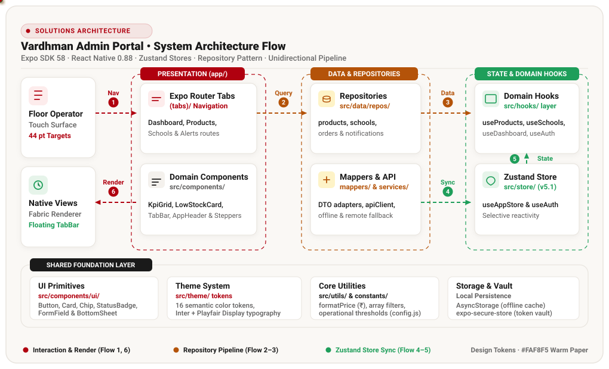

# Vardhman Admin Portal

<p align="center">
  <picture>
    <source media="(prefers-color-scheme: dark)" srcset="docs/readme/banner-dark.svg" />
    <source media="(prefers-color-scheme: light)" srcset="docs/readme/banner-light.svg" />
    
  </picture>
</p>

<p align="center">
  <a href="https://git.io/typing-svg">
    
  </a>
</p>

<p align="center">
  <a href="https://reactnative.dev/"></a>
  <a href="https://expo.dev/"></a>
  <a href="https://developer.mozilla.org/en-US/docs/Web/JavaScript"></a>
  <a href="https://github.com/pmndrs/zustand"></a>
  <a href="https://react-hook-form.com/"></a>
  <a href="https://developer.android.com/"></a>
  
</p>

<p align="center">
  <a href="#-overview">Overview</a> · <a href="#-tech-stack--languages">Tech Stack</a> · <a href="#-architecture">Architecture</a> · <a href="#-design-system--tokens">Design System</a> · <a href="#-project-structure">Structure</a> · <a href="#-getting-started">Getting Started</a> · <a href="#-code-quality">Code Quality</a>
</p>

---

## 📌 Overview

**Vardhman Admin Portal** is a dedicated mobile operations and inventory management system designed for **Vardhman School Uniforms (VSU)**. It equips floor administrators, inventory controllers, and logistics personnel with a fast, touch-first tool to oversee multi-school uniform catalogs, track real-time SKU stock levels, manage low-inventory replenishment alerts, and process partner school distribution schedules directly from Android devices.

The mobile client leverages the **React Native New Architecture** and **Expo SDK 58**, featuring a decoupled repository pattern that enables transparent switching between local offline persistence (`AsyncStorage`) and remote REST endpoints.

### Highlights

<table>
  <tr>
    <td width="50%" valign="top">
      <h4>⚡ Real-Time Inventory &amp; SKU Oversight</h4>
      <p>Granular size-level inventory control across five uniform categories (Tops, Bottoms, Winterwear, Footwear, Accessories) with automated low-stock and out-of-stock indicators.</p>
    </td>
    <td width="50%" valign="top">
      <h4>🏫 Institutional School Mapping</h4>
      <p>Management of partner academic institutions, board affiliations (CBSE, ICSE, State Boards), active grade configurations, and institution crest assets.</p>
    </td>
  </tr>
  <tr>
    <td width="50%" valign="top">
      <h4>📦 Order Dispatch &amp; Fulfillment</h4>
      <p>Daily operations overview tracking packing status, delivery schedules, shipment dispatch queues, and critical order priority flags.</p>
    </td>
    <td width="50%" valign="top">
      <h4>🔔 Proactive Notification Center</h4>
      <p>Categorized operational stream delivering immediate notices for low inventory thresholds, urgent dispatches, and catalog updates.</p>
    </td>
  </tr>
  <tr>
    <td width="50%" valign="top">
      <h4>🛡️ Decoupled Repository Pattern</h4>
      <p>Clean architectural separation between UI controllers and data sources, allowing transparent switching between local offline persistence and production REST services.</p>
    </td>
    <td width="50%" valign="top">
      <h4>🎯 Warehouse Floor Ergonomics</h4>
      <p>Built for high-volume single-handed usage with strict 44×44 pt touch targets, premium floating pill navigation bar, and tactile visual feedback.</p>
    </td>
  </tr>
</table>

---

## 🛠️ Tech Stack &amp; Languages

The application is built on modern JavaScript (ES2022) with React Native and Expo SDK 58, operating on the React Native New Architecture for direct native thread performance.

<p align="center">
  
</p>

<p align="center">
  
</p>

### Dependencies &amp; Versions

| Layer | Technology | Version | Purpose |
| :--- | :--- | :--- | :--- |
| **Core Framework** | [React](https://react.dev/) | `19.3.0` | Declarative UI component model &amp; concurrent renderer |
| **Mobile Runtime** | [React Native](https://reactnative.dev/) | `0.88.1` | Native cross-platform engine (New Architecture enabled) |
| **Application Toolchain** | [Expo SDK](https://expo.dev/) | `~58.0.26` | Unified native module runtime, dev tools, and compiler ecosystem |
| **Navigation &amp; Routing** | [Expo Router](https://docs.expo.dev/router/introduction/) | `~58.0.32` | File-system-based routing with deep-link state management |
| **Global State** | [Zustand](https://github.com/pmndrs/zustand) | `^5.1.0` | High-performance, unopinionated reactive state store |
| **Form Management** | [React Hook Form](https://react-hook-form.com/) | `^7.92.0` | Uncontrolled form validation state with minimal re-renders |
| **Schema Validation** | [Zod](https://zod.dev/) | `^4.6.7` | Type-safe runtime input parsing and validation schema |
| **Validation Bridge** | `@hookform/resolvers` | `^7.0.7` | React Hook Form resolver adapter for Zod schemas |
| **Local Cache** | `@react-native-async-storage/async-storage` | `2.2.0` | Persistent asynchronous key-value storage for drafts and filters |
| **Encrypted Storage** | `expo-secure-store` | `~58.0.3` | Encrypted hardware-backed key-value persistence |
| **Image Pipeline** | `expo-image` | `~58.0.18` | Hardware-accelerated image decoding, disk caching, and progressive loading |
| **Media Selection** | `expo-image-picker` | `~58.0.10` | Device camera capture and photo gallery picker for catalog assets |
| **Iconography** | `@expo/vector-icons` | `^15.0.2` | Normalized Material and Feather vector icon collections |
| **Interface Typography** | `@expo-google-fonts/inter` | `^0.4.2` | Clean neutral sans-serif typography across 400, 500, 600, 700 weights |
| **Brand Wordmark** | `@expo-google-fonts/playfair-display` | `^0.4.2` | High-contrast editorial serif for canonical Vardhman branding |
| **Font Subsystem** | `expo-font` | `~58.0.12` | Asynchronous native font asset loader |
| **Screen Management** | `react-native-screens` | `~4.30.1` | Native UIViewController and Android Fragment navigation containers |
| **Safe Area Insets** | `react-native-safe-area-context` | `~5.11.1` | Notch, dynamic island, and gesture-bar inset calculations |
| **Environment Config** | `expo-constants` | `~58.0.16` | System properties, manifest variables, and device capabilities |
| **Status Bar Control** | `expo-status-bar` | `~58.0.5` | Reactive theme-aware Android system status bar tinting |
| **Cloud Compilation** | EAS Build | `Profile-driven` | Cloud native APK and AAB build pipeline (`eas.json`) |
| **Code Hygiene** | CSpell | `^0.2` | Multi-dictionary terminology and domain spell-checker (`cspell.json`) |
| **Import Paths** | Path Aliasing | `jsconfig.json` | Clean root path aliases (`@/*` resolving to `./src/*`) |

### npm Scripts

| Script | Command | Description |
| :--- | :--- | :--- |
| `npm start` | `expo start` | Start the interactive Expo development server |
| `npm run android` | `expo start --android` | Launch directly on active Android emulator / tethered device |
| `npm run ios` | `expo start --ios` | Launch on iOS Simulator (macOS environment) |
| `npm run web` | `expo start --web` | Start local web development preview |

---

## 🏛️ Architecture

The application adheres to a clean, unidirectional layered architecture where screens consume custom domain hooks, reactive stores handle global UI state, and repository contracts isolate data access from presentation concerns.

<p align="center">
  
</p>

### Architectural Principles

- **Unidirectional Data Flow.** Touch events trigger navigation or domain hook actions, which query repository facades, commit state to Zustand stores, and propagate reactive updates down to native view trees.
- **Repository Pattern Abstraction.** All data access is mediated through repository contracts (`productsRepo`, `schoolsRepo`, `ordersRepo`, `notificationsRepo`). Screens and hooks interact solely with repository interfaces, enabling transparent switching between offline cache and REST APIs.
- **Selective Reactivity via Zustand.** Application state is partitioned into lightweight slices (`useAppStore`, `useAuthStore`). Components subscribe strictly to relevant selectors, eliminating redundant full-tree re-renders.
- **Hardware-Backed Persistence.** Sensitive authentication tokens and session credentials are encrypted in hardware via `expo-secure-store`, while operational drafts and filter presets leverage `@react-native-async-storage/async-storage`.
- **New Architecture Performance.** React Native 0.88 with Fabric renderer enables synchronous native layout calculation, direct C++ JSI communication, and butter-smooth 60fps gesture response.

---

## 🎨 Design System &amp; Tokens

All interface styling adheres to a centralized token architecture defined in `src/theme/`. The visual language combines Vardhman's crimson heritage identity (`#B0000F`) with clean industrial ergonomics and high-contrast charcoal typography.

<p align="center">
  
</p>

### Typography Hierarchy

```
Playfair Display Bold (700) ─── Brand Wordmark (22pt / 26pt line-height)
Inter Bold (700) ────────────── Page Titles (18pt), KPI Digits (26pt), Card Titles (16pt)
Inter SemiBold (600) ────────── Section Headers (14pt), Action Pills
Inter Medium (500) ──────────── Interactive Buttons (14pt), Subtext (12pt), Captions (11pt)
Inter Regular (400) ─────────── Body Text (14pt / 20pt line-height), Descriptions
```

### Spacing, Radii &amp; Ergonomics Scale

| Dimension Token | Value | Applied Design Role |
| :--- | :--- | :--- |
| `spacing.xs` / `sm` | `4px` / `8px` | Icon gutters, inline badge paddings, tag borders |
| `spacing.md` / `lg` | `12px` / `16px` | Card internal padding, form row vertical separation, screen gutters |
| `spacing.xl` / `xxl` | `20px` / `24px` | Section dividers, header margins, bottom sheet spacing |
| `radii.sm` / `md` | `6px` / `8px` | Form input borders, small buttons, status indicators |
| `radii.lg` / `formCard` | `12px` / `14px` | Elevated nested tiles, grouped input containers |
| `radii.card` | `16px` | Top-level operational cards, overview panels, dialogs |
| `radii.full` | `9999px` | Floating pill tab bar, circular avatar badges, filter chips |
| `layout.minTouchTarget` | `44 pt` | Minimum interactive surface across all touch controls |
| `layout.buttonHeight` | `48 pt` | Normalized touch-friendly action button height |
| `layout.floatingTabBarHeight` | `52 pt` | Floating pill navigation bar height |
| `layout.headerHeight` | `64 pt` | Fixed viewport header bar dimension |

### Foundation UI Components (`src/components/ui/`)

- **`Button`**: Supports `primary`, `secondary`, `outline`, `dark`, `ghost`, and `danger` variants with integrated loading spinners and left/right icon slots.
- **`Card`**: Surface container with standardized warm border (`#E8E3DE`), subtle elevation, and touchable feedback.
- **`Chip`**: Interactive pill filter with selected active states and optional item count counters.
- **`StatusBadge`**: Normalized semantic badge system mapping order and stock states (`new`, `packed`, `delivered`, `published`, `low_stock`, `out_of_stock`, `draft`).
- **`FormField`**: Text input wrapper with active focus ring transitions, leading/trailing icons, error helpers, and multi-line support.
- **`BottomSheet`**: Native modal slide-up drawer with handle bar, backdrop scrim (`rgba(0,0,0,0.45)`), and safe-area constraints.
- **`TabBar`**: Premium floating pill navigation bar with active blush background, smooth label visibility, and badge support.
- **`SegmentedControl`**: Dual/triple tab switcher for filtering operational views.
- **`SearchBar`**: Real-time filter field with instant clear trigger.
- **`Toggle`**: Tactile boolean switch for status updates.
- **`EmptyState`**: Standardized zero-data fallback screen with domain illustrations and action buttons.
- **`Icon`**: Normalized vector icon primitive referencing `@expo/vector-icons`.

---

## 📁 Project Structure

```
VARDHMAN-ADMIN-APK/
├── app/                        # Expo Router: file-based routes & navigation
│   ├── (tabs)/                 # Main tab layout & views
│   │   ├── index.jsx           # Dashboard: KPIs, low-stock, overview
│   │   ├── products.jsx        # Product catalog: SKU tracking, filters
│   │   ├── schools.jsx         # School registry: board & grade configurations
│   │   ├── notifications.jsx   # Operational notification center
│   │   └── _layout.jsx         # Tab navigator with floating pill TabBar
│   ├── products/new.jsx        # Add uniform SKU modal form
│   ├── schools/new.jsx         # Register partner school modal form
│   └── _layout.jsx             # Root stack navigator & font splash handler
├── assets/                     # Media files, brand logos & visual assets
│   ├── products/               # Bundled uniform catalog assets
│   └── vsu-logo.jpeg           # Official Vardhman School Uniforms crest
├── docs/
│   └── readme/                 # SVG graphics, banners & technical diagrams
│       ├── banner.svg          # Adaptive dual-mode brand banner
│       ├── banner-dark.svg     # Dark theme banner
│       ├── banner-light.svg    # Light theme banner
│       ├── architecture.svg    # Animated system architecture flowchart
│       ├── tech-stack.svg      # Component chip ecosystem graphic
│       ├── languages.svg       # Codebase composition bar chart
│       ├── palette.svg         # Centralized color swatch grid
│       └── divider.svg         # Animated gradient section divider
├── src/
│   ├── components/             # Reusable UI component modules
│   │   ├── dashboard/          # KPI metrics, low-stock & order cards
│   │   ├── layout/             # AppHeader, TabBar & StickyActionBar
│   │   ├── notifications/      # Operational notification list items
│   │   ├── products/           # Product cards, size tables & image picker
│   │   ├── schools/            # Partner school rows & class selectors
│   │   └── ui/                 # Design system foundation primitives
│   ├── constants/              # Asset maps, category enums & configuration
│   ├── data/                   # Data mappers, adapters & repository contracts
│   │   ├── mappers/            # Domain model transformers (product, school, order)
│   │   └── repositories/       # productsRepo, schoolsRepo, ordersRepo, notificationsRepo
│   ├── hooks/                  # Domain lifecycle hooks (useProducts, useSchools...)
│   ├── services/               # HTTP client & API abstraction layer
│   ├── store/                  # Zustand global application state slices
│   ├── theme/                  # Design tokens: colors, spacing, typography
│   └── utils/                  # Formatters, array utilities & helpers
├── app.json                    # Expo project configuration & build plugins
├── cspell.json                 # Domain dictionary & spellcheck config
├── eas.json                    # EAS build compilation profiles
├── jsconfig.json               # Path alias mappings (@/* -> ./src/*)
└── package.json                # Dependency manifest & npm scripts
```

---

## 🚀 Getting Started

### Prerequisites

- **[Node.js](https://nodejs.org/)**: Version `18.x` or `20.x` (LTS recommended)
- **[npm](https://www.npmjs.com/)**: Version `9.x` or higher
- **Android Environment**: [Android Studio](https://developer.android.com/studio) (for local Emulator testing) or the **[Expo Go](https://expo.dev/go)** app on a physical Android device

### Installation &amp; Execution

1. **Clone the repository**:
   ```bash
   git clone https://github.com/R3DH47-ui/VARDHMAN-ADMIN-APK.git
   cd VARDHMAN-ADMIN-APK
   ```

2. **Install project dependencies**:
   ```bash
   npm install --legacy-peer-deps
   ```

3. **Start the Expo development server**:
   ```bash
   npm start
   ```

4. **Launch on Android**:
   - Press <kbd>a</kbd> in the terminal to automatically connect to an active Android Emulator or USB-tethered Android device.
   - Alternatively, scan the generated terminal QR code with the **Expo Go** application.

---

## ✅ Code Quality

- **Modern JavaScript** — clean ES2022 syntax throughout, zero compilation bottlenecks, native ES module imports with `@/*` aliases.
- **Strict Schema Validation** — all operational forms and mutations are validated via Zod schemas and integrated seamlessly using `@hookform/resolvers`.
- **Encrypted Storage Vault** — authentication tokens, session secrets, and security credentials are encrypted via `expo-secure-store`.
- **Offline-First Resilience** — repository layer seamlessly manages local disk cache fallbacks, preventing network latency from impeding warehouse floor operations.
- **Ergonomic Touch Compliance** — strict adherence to minimum 44×44 pt touch targets, persistent floating action controls, and tactile feedback.

---

## 📄 License &amp; Terms

This project repository contains a [LICENSE](LICENSE) file specifying the **MIT License** (Copyright &copy; Expo / 650 Industries, Inc.).

> [!NOTE]
> All proprietary brand assets, logos, school partner affiliations, catalog uniform designs, and operational trademarks belong exclusively to **Vardhman School Uniforms**.

---

<p align="center">
  
</p>

<p align="center">
  <sub>Built with precision for <strong>Vardhman School Uniforms</strong> • Mobile Operations &amp; Inventory Management Portal</sub>
</p>
