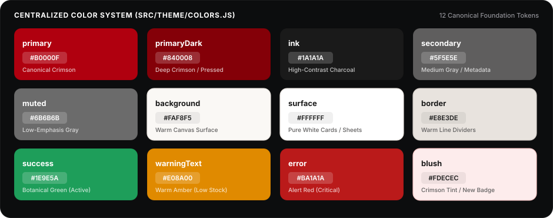
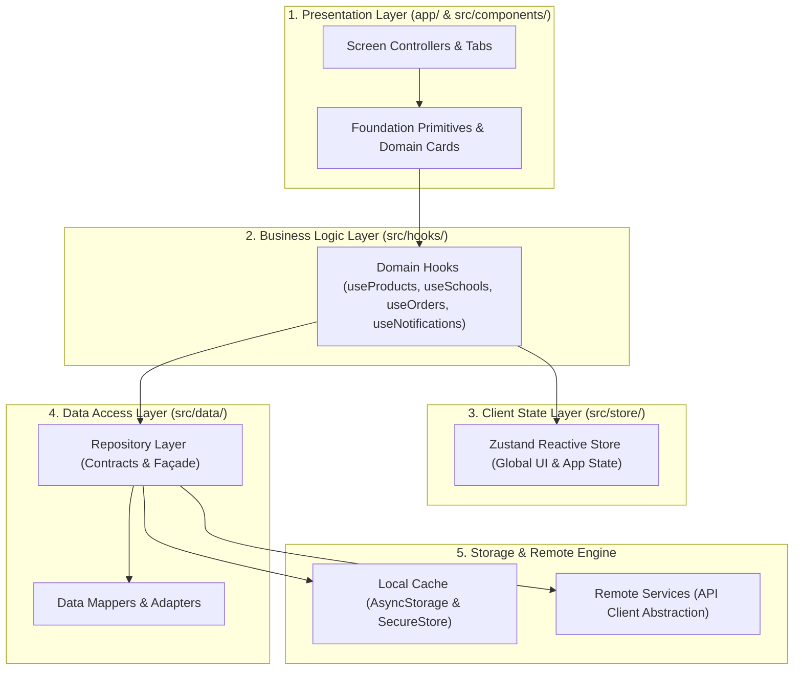

# Vardhman Admin Portal

<p align="center">
  
  <picture>
    <source media="(prefers-color-scheme: dark)" srcset="assets/readme/banner-dark.svg" />
    <source media="(prefers-color-scheme: light)" srcset="assets/readme/banner-light.svg" />
    
  </picture>
</p>

<p align="center">
  <strong>Modern Mobile Operations & Inventory Management for Vardhman Uniforms</strong>
  <a href="https://git.io/typing-svg">
    
  </a>
</p>

<p align="center">
  
  
  
  
  
  <a href="https://reactnative.dev/"></a>
  <a href="https://expo.dev/"></a>
  <a href="https://developer.mozilla.org/en-US/docs/Web/JavaScript"></a>
  <a href="https://github.com/pmndrs/zustand"></a>
  <a href="https://react-hook-form.com/"></a>
  <a href="https://developer.android.com/"></a>
  
</p>

---

## 📌 About the Project
## 📌 Overview

**Vardhman Admin Portal** is an enterprise-grade mobile companion application built for streamlined management of school uniform manufacturing, cataloging, and institutional distribution. 
**Vardhman Admin Portal** is a dedicated mobile operations and inventory management system designed for **Vardhman School Uniforms (VSU)**. It equips floor administrators, inventory controllers, and logistics personnel with a fast, touch-first tool to oversee multi-school uniform catalogs, track real-time SKU stock levels, manage low-inventory replenishment alerts, and process partner school distribution schedules directly from Android devices.

The application empowers administrators and floor managers to oversee multi-school uniform catalogs, track real-time stock levels, manage low-inventory alerts, review daily operational orders, and onboard partner academic institutions directly from a handheld device.

### Key Capabilities
- **Operational Dashboard**: Real-time KPI summary, dispatch tracking, active SKU counts, and critical low-stock attention lists.
- **Product Catalog Management**: Comprehensive product listings categorized by uniform type (Tops, Bottoms, Winter, Accessories, Footwear) with granular size-level inventory control.
- **Institutional School Mapping**: Management of partner schools with board affiliations (CBSE, ICSE, State Boards), mapped class ranges, and official crest assets.
- **Notification Center**: Operational updates, order progress notifications, and automated inventory threshold alerts.
- **Decoupled Architecture**: Repository-based service design allowing seamless switching between local offline data and production REST backends without UI modifications.

<table>
  <tr>
    <td width="50%" valign="top">
      <h4>⚡ Real-Time Inventory &amp; SKU Oversight</h4>
      <p>Granular size-level inventory control across five uniform categories (Tops, Bottoms, Winterwear, Footwear, Accessories) with automated low-stock and out-of-stock indicators.</p>
    </td>
    <td width="50%" valign="top">
      <h4>🏫 Institutional School Mapping</h4>
      <p>Management of partner academic institutions, board affiliations (CBSE, ICSE, State Boards), active grade configurations, and institution crest assets.</p>
    </td>
  </tr>
  <tr>
    <td width="50%" valign="top">
      <h4>📦 Order Dispatch &amp; Fulfillment</h4>
      <p>Daily operations overview tracking packing status, delivery schedules, shipment dispatch queues, and critical order priority flags.</p>
    </td>
    <td width="50%" valign="top">
      <h4>🔔 Proactive Notification Center</h4>
      <p>Categorized operational stream delivering immediate notices for low inventory thresholds, urgent dispatches, and catalog updates.</p>
    </td>
  </tr>
  <tr>
    <td width="50%" valign="top">
      <h4>🛡️ Decoupled Repository Pattern</h4>
      <p>Clean architectural separation between UI controllers and data sources, allowing transparent switching between local offline persistence and production REST services.</p>
    </td>
    <td width="50%" valign="top">
      <h4>🎯 Warehouse Floor Ergonomics</h4>
      <p>Built for high-volume single-handed usage with strict 44×44 pt touch targets, persistent bottom action bars, and tactile visual feedback.</p>
    </td>
  </tr>
</table>

---

## 🛠️ Technology Stack
## 🛠️ Technology Stack &amp; Languages

The project is developed strictly in modern JavaScript (ES2022) with a performance-first mobile architectural foundation.
The application is built on modern JavaScript (ES2022) with React Native and Expo SDK 58, operating on the React Native New Architecture for direct native thread performance.

<p align="center">
  
</p>

<p align="center">
  
</p>

### Dependencies &amp; Version Specifications

| Layer | Technology | Version | Purpose |
| :--- | :--- | :--- | :--- |
| **Core Framework** | [React Native](https://reactnative.dev/) | `0.88.1` | Mobile native view controllers and layout engine |
| **Platform Runtime** | [Expo SDK](https://expo.dev/) | `~58.0.26` | Unified build ecosystem, native modules, and tooling |
| **Navigation** | [Expo Router](https://docs.expo.dev/router/introduction/) | `~58.0.32` | File-system-based navigation and deep linking |
| **State Management** | [Zustand](https://github.com/pmndrs/zustand) | `^5.1.0` | Lightweight, scalable global state store |
| **Form & Validation** | [React Hook Form](https://react-hook-form.com/) & [Zod](https://zod.dev/) | `^7.92.0` / `^4.6.7` | High-performance form state and schema validation |
| **Typography** | Inter & Playfair Display | Google Fonts | Primary UI and premium serif brand wordmark |
| **Vector Icons** | `@expo/vector-icons` | `^15.0.2` | Normalized Material design iconography |
| **Image Engine** | React Native Image & `expo-image` | `~58.0.18` | Hardware-accelerated image rendering and caching |
| **Local Storage** | Async Storage & Secure Store | `2.2.0` / `~58.0.3` | Persistent form drafts and session credentials |
| **Core Framework** | [React](https://react.dev/) | `19.3.0` | Core declarative UI component model |
| **Mobile Runtime** | [React Native](https://reactnative.dev/) | `0.88.1` | Native cross-platform engine (New Architecture enabled) |
| **Application Toolchain** | [Expo SDK](https://expo.dev/) | `~58.0.26` | Unified native module runtime, dev tools, and compiler ecosystem |
| **Navigation &amp; Routing** | [Expo Router](https://docs.expo.dev/router/introduction/) | `~58.0.32` | File-system-based routing with deep-link state management |
| **Global State** | [Zustand](https://github.com/pmndrs/zustand) | `^5.1.0` | High-performance, unopinionated reactive state store |
| **Form Management** | [React Hook Form](https://react-hook-form.com/) | `^7.92.0` | Uncontrolled form validation state with minimal re-renders |
| **Schema Validation** | [Zod](https://zod.dev/) | `^4.6.7` | Type-safe runtime input parsing and validation schema |
| **Validation Bridge** | `@hookform/resolvers` | `^7.0.7` | React Hook Form resolver adapter for Zod schemas |
| **Local Cache** | `@react-native-async-storage/async-storage` | `2.2.0` | Persistent asynchronous key-value storage for drafts and filters |
| **Encrypted Storage** | `expo-secure-store` | `~58.0.3` | Encrypted hardware-backed key-value persistence |
| **Image Pipeline** | `expo-image` | `~58.0.18` | Hardware-accelerated image decoding, disk caching, and progressive loading |
| **Media Selection** | `expo-image-picker` | `~58.0.10` | Device camera capture and photo gallery picker for catalog assets |
| **Iconography** | `@expo/vector-icons` | `^15.0.2` | Normalized Material and Feather vector icon collections |
| **Interface Typography** | `@expo-google-fonts/inter` | `^0.4.2` | Clean neutral sans-serif typography across 400, 500, 600, 700 weights |
| **Brand Wordmark** | `@expo-google-fonts/playfair-display` | `^0.4.2` | High-contrast editorial serif for canonical Vardhman branding |
| **Font Subsystem** | `expo-font` | `~58.0.12` | Asynchronous native font asset loader |
| **Screen Management** | `react-native-screens` | `~4.30.1` | Native UIViewController and Android Fragment navigation containers |
| **Safe Area Insets** | `react-native-safe-area-context` | `~5.11.1` | Notch, dynamic island, and gesture-bar inset calculations |
| **Environment Config** | `expo-constants` | `~58.0.16` | System properties, manifest variables, and device capabilities |
| **Status Bar Control** | `expo-status-bar` | `~58.0.5` | Reactive theme-aware Android system status bar tinting |
| **Cloud Compilation** | EAS Build | `Profile-driven` | Cloud native APK and AAB build pipeline (`eas.json`) |
| **Code Hygiene** | CSpell | `^0.2` | Multi-dictionary terminology and domain spell-checker (`cspell.json`) |
| **Import Paths** | Path Aliasing | `jsconfig.json` | Clean root path aliases (`@/*` resolving to `./src/*`) |

---

## 🎨 Design System & Theme
## 🎨 Design System &amp; Tokens

The user interface follows a tailored, bespoke aesthetic combining Indian heritage elegance with modern industrial operational efficiency. All design tokens are centralized in `src/theme/`.
All interface styling adheres to a centralized token architecture defined in `src/theme/`. The visual language combines Vardhman's crimson heritage identity with clean industrial ergonomics.

### Color Palette
<p align="center">
  
</p>

| Token | Hex Value | Role in Design |
### Typography Hierarchy

```
Playfair Display Bold (700) ─── Brand Wordmark (22pt / 26pt line-height)
Inter Bold (700) ────────────── Page Titles (18pt), KPI Digits (26pt), Card Titles (16pt)
Inter SemiBold (600) ────────── Section Headers (14pt), Action Pills
Inter Medium (500) ──────────── Interactive Buttons (14pt), Subtext (12pt), Captions (11pt)
Inter Regular (400) ─────────── Body Text (14pt / 20pt line-height), Descriptions
```

### Spacing, Radii &amp; Ergonomics Scale

| Dimension Token | Value | Applied Design Role |
| :--- | :--- | :--- |
| `primary` | `#B0000F` | Canonical Vardhman Crimson — action buttons, primary branding, active highlights |
| `primaryDark` | `#840008` | Deep Crimson — pressed states and elevated accents |
| `background` | `#FAF8F5` | Warm Canvas — soft, low-fatigue off-white screen surface |
| `surface` | `#FFFFFF` | Pure White — cards, sheets, top header card, and bottom navigation bar |
| `ink` | `#1A1A1A` | High-contrast Charcoal — headlines, SKU numbers, and high-emphasis labels |
| `secondary` | `#5F5E5E` | Medium Gray — metadata, institution sub-labels, and neutral icons |
| `muted` | `#6B6B6B` | Low-emphasis Gray — placeholders, inactive tabs, and timestamp captions |
| `border` | `#E8E3DE` | Warm Line — subtle card borders and structural dividers |
| `success` | `#1E9E5A` | Botanical Green — published status badges, positive operational diffs |
| `warning` | `#E08A00` | Warm Amber — low-stock warnings and attention indicators |
| `error` | `#BA1A1A` | Pure Red — out-of-stock badges and critical stock notices |
| `spacing.xs` / `sm` | `4px` / `8px` | Icon gutters, inline badge paddings, tag borders |
| `spacing.md` / `lg` | `12px` / `16px` | Card internal padding, form row vertical separation, screen gutters |
| `spacing.xl` / `xxl` | `20px` / `24px` | Section dividers, header margins, bottom sheet spacing |
| `radii.sm` / `md` | `6px` / `8px` | Form input borders, small buttons, status indicators |
| `radii.lg` / `formCard` | `12px` / `14px` | Elevated nested tiles, grouped input containers |
| `radii.card` | `16px` | Top-level operational cards, overview panels, dialogs |
| `radii.full` | `9999px` | Circular avatar badges, filter chips, action pills |
| `layout.minTouchTarget` | `44 pt` | Minimum interactive surface across all touch controls |
| `layout.buttonHeight` | `48 pt` | Normalized touch-friendly action button height |
| `layout.headerHeight` / `tabBarHeight` | `64 pt` / `64 pt` | Fixed viewport navigation bar dimensions |

### Typography & Layout Rules
- **Brand Wordmark**: *Playfair Display (Bold)* for the distinctive Vardhman identity.
- **Interface Font**: *Inter* across 400 (Regular), 500 (Medium), 600 (SemiBold), and 700 (Bold) weights for numeric legibility and clean mobile hierarchy.
- **Border Radii**: Modular scaling with `sm: 6px`, `md: 8px`, `lg: 12px`, `card: 16px`, and `full: 9999px`.
- **Touch Ergonomics**: All interactive elements strictly enforce a minimum touch target of 44×44 pt with safe area insets.
### Foundation UI Components (`src/components/ui/`)

- **`Button`**: Supports `primary`, `secondary`, `outline`, `dark`, `ghost`, and `danger` variants with integrated loading spinners and left/right icon slots.
- **`Card`**: Surface container with standardized warm border (`#E8E3DE`), subtle elevation (`elevation: 1`), and touchable feedback.
- **`Chip`**: Interactive pill filter with selected active states and optional item count counters.
- **`StatusBadge`**: Normalized semantic badge system mapping order and stock states (`new`, `packed`, `delivered`, `published`, `low_stock`, `out_of_stock`, `draft`).
- **`FormField`**: Text input wrapper with active focus ring transitions, leading/trailing icons, error helpers, and multi-line support.
- **`BottomSheet`**: Native modal slide-up drawer with handle bar, backdrop scrim (`rgba(0,0,0,0.45)`), and safe-area constraints.
- **`SegmentedControl`**: Dual/triple tab switcher for filtering operational views.
- **`SearchBar`**: Real-time filter field with instant clear trigger.
- **`Toggle`**: Tactile boolean switch for status updates.
- **`EmptyState`**: Standardized zero-data fallback screen with domain illustrations and action buttons.
- **`Icon`**: Normalized vector icon primitive referencing `@expo/vector-icons`.

---

## 🏛️ Architecture Overview

The codebase is organized into unidirectional decoupled layers. Screen controllers consume custom domain hooks, which interact with global reactive stores and the repository abstraction layer.



---

## 📁 Project Structure

```
VARDHMAN-ADMIN-APK/
├── app/                              # Application screen layouts and views
│   ├── (tabs)/                       # Bottom tab navigation screens
│   ├── products/                     # Product authoring and edit workflows
│   └── schools/                      # School onboarding workflows
├── assets/                           # Static media, icons, and bundled uniform imagery
│   └── products/                     # High-resolution catalog product images
VARDHMAN-ADMIN/
├── assets/                     # Media files, brand logos & visual assets
│   ├── products/               # Bundled uniform catalog assets
│   ├── readme/                 # SVG graphics, banners & technical diagrams
│   └── vsu-logo.jpeg           # Official Vardhman School Uniforms crest
├── src/
│   ├── components/                   # Modular, reusable presentation components
│   │   ├── dashboard/                # Operational summary and KPI cards
│   │   ├── layout/                   # Universal headers, navigation bar, action bars
│   │   ├── notifications/            # Alert and notice list items
│   │   ├── products/                 # Product row cards, thumbnails, stock grids
│   │   ├── schools/                  # School cards, class selectors, crest uploaders
│   │   └── ui/                       # Foundation buttons, chips, badges, inputs
│   ├── constants/                    # Enums, statuses, and asset resolvers
│   ├── data/                         # Data layer and abstraction
│   │   ├── mappers/                  # Model data transformation adapters
│   │   └── repositories/             # Unified repositories (offline-first & remote)
│   ├── hooks/                        # Custom React state and data hooks
│   ├── services/                     # Network clients and communication utilities
│   ├── store/                        # Global state management stores
│   ├── theme/                        # Centralized design tokens (colors, typography, spacing)
│   └── utils/                        # Formatting utilities and data helpers
├── app.json                          # Expo project configuration
├── eas.json                          # EAS cloud build profiles
├── jsconfig.json                     # Root path aliases (@/* -> ./src/*)
└── package.json                      # Project dependencies and script declarations
│   ├── components/             # Reusable UI component modules
│   │   ├── dashboard/          # KPI metrics, low-stock & order cards
│   │   ├── layout/             # Universal headers, tab bar & sticky actions
│   │   ├── notifications/      # Operational notification list items
│   │   ├── products/           # Product cards, size tables & image picker
│   │   ├── schools/            # Partner school rows & class selectors
│   │   └── ui/                 # Design system foundation primitives
│   ├── constants/              # Asset maps, category enums & configuration
│   ├── data/                   # Data mappers, adapters & repository contracts
│   ├── hooks/                  # Custom lifecycle & domain logic hooks
│   ├── services/               # HTTP client & API abstraction layer
│   ├── store/                  # Zustand global application state slices
│   ├── theme/                  # Design tokens: colors, spacing, typography
│   └── utils/                  # Formatters, array utilities & helpers
├── app.json                    # Expo project configuration & build plugins
├── cspell.json                 # Domain dictionary & spellcheck config
├── eas.json                    # EAS build compilation profiles
├── jsconfig.json               # Path alias mappings (@/* -> ./src/*)
└── package.json                # Dependency manifest & npm scripts
```

---

## 🚀 Getting Started

### Prerequisites
- [Node.js](https://nodejs.org/) (v18 or higher recommended)
- [npm](https://www.npmjs.com/) or [yarn](https://yarnpkg.com/)
- [Expo Go](https://expo.dev/go) on an Android device or an active Android Emulator

### Installation & Run
- **[Node.js](https://nodejs.org/)**: Version `18.x` or `20.x` (LTS recommended)
- **[npm](https://www.npmjs.com/)**: Version `9.x` or higher
- **Android Environment**: [Android Studio](https://developer.android.com/studio) (for local Emulator testing) or the **[Expo Go](https://expo.dev/go)** app on a physical Android device

### Installation &amp; Execution

1. **Clone the repository**:
   ```bash
   git clone https://github.com/R3DH47-ui/VARDHMAN-ADMIN.git
   cd VARDHMAN-ADMIN-APK
   cd VARDHMAN-ADMIN
   ```

2. **Install dependencies**:
2. **Install project dependencies**:
   ```bash
   npm install --legacy-peer-deps
   ```

3. **Start the development server**:
3. **Start the Expo development server**:
   ```bash
   npx expo start
   ```

4. **Run on Android**:
   - Press `a` in the terminal to launch on a connected Android device / emulator.
   - Or scan the terminal QR code using the **Expo Go** application.
4. **Launch on Android**:
   - Press <kbd>a</kbd> in the terminal to automatically connect to an active Android Emulator or USB-tethered Android device.
   - Alternatively, scan the generated terminal QR code with the **Expo Go** application.

---

## 📄 License
## 📄 License &amp; Terms

This project is proprietary and confidential. Unauthorized copying, distribution, or modification is strictly prohibited.
This project repository contains a [LICENSE](LICENSE) file specifying the **MIT License** (Copyright &copy; Expo / 650 Industries, Inc.). 

> [!NOTE]
> All proprietary brand assets, logos, school partner affiliations, catalog uniform designs, and operational trademarks belong exclusively to **Vardhman School Uniforms**. 

---

<p align="center">
  
</p>

<p align="center">
  <sub>Built with precision for <strong>Vardhman School Uniforms</strong> • Operations &amp; Inventory Management Portal</sub>
</p>
